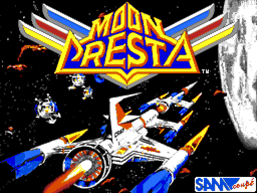

# Moon Cresta — SAM Coupé

Nichibutsu's 1980 arcade classic, rebuilt for the SAM Coupé in Z80 machine code, with its attack patterns, sounds, docking, scoring and loop taken from the original arcade program.

**[Download the disk image (MoonCresta.mgt)](download/MoonCresta.mgt)** · **[Project page](https://YOUR-USERNAME.github.io/mooncresta/)**

## Play

Boot `MoonCresta.mgt` on a SAM Coupé (write it to an 800K disk) or in SimCoupé (insert it in drive 1 and reset). The disk loads the Lightning Studios intro, then the loading screen, then the game.

| Key | Action |
| --- | --- |
| 4 | Insert credit |
| 1 / 2 | 1 or 2 players |
| 3 | Define keys |
| Z, X, Space | Left, right, fire (defaults) |
| Cursors / joystick | Also work |
| Fire while docking | Thrust |

## Features

- The full three-stage rocket: lose a stage and the survivors regroup; each stage fires on its own.
- Five enemy types on their arcade flight paths: Cold Eye, Super Fly, Four-D, Meteor, Atomic Pile.
- Docking against gravity and a 30-second clock, with × 100, × 200 or × 300 bonuses.
- Far Out ending and harder loops; extra rocket at 30,000 points.
- Main menu, 1 or 2 players, redefinable keys, credits, and a full attract mode.
- High-score table; the top scorer's initials replace the Nichibutsu logo.

## Built from the arcade

The original Moon Cresta ROM was decoded and run in a purpose-built arcade emulator that logs sprites, sound and memory frame by frame. Enemy flight tables, melodies, sound effects, docking physics, explosions and scoring were taken from it and checked side by side against the SAM version.

## Credits

- SAM Coupé conversion: Lightning Studios, 2026 — artwork, loading screen, intro, direction and play-testing.
- Z80 programming written with Claude (Anthropic).
- Moon Cresta © 1980 Nichibutsu. A fan conversion, not affiliated with or endorsed by the rights holders.
